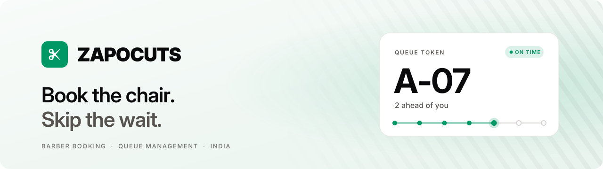
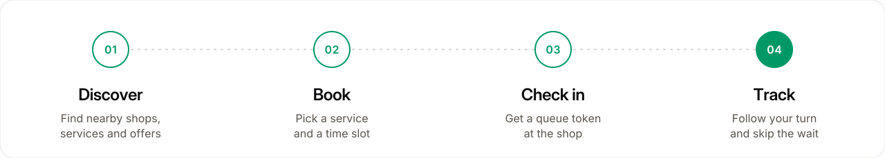

<picture>
  <source media="(prefers-color-scheme: dark)" srcset="assets/banner-dark.svg">
  <source media="(prefers-color-scheme: light)" srcset="assets/banner-light.svg">
  
</picture>

## What we're building

Zapocuts is a platform for booking haircuts and managing walk-in queues. It connects customers with nearby barber shops and gives shops simple tools to run appointments and queues without changing how they already work.

The platform is currently in development.

## What the platform aims to do

<picture>
  <source media="(prefers-color-scheme: dark)" srcset="assets/how-it-works-dark.svg">
  <source media="(prefers-color-scheme: light)" srcset="assets/how-it-works-light.svg">
  
</picture>

**For customers**

- Find nearby barber shops and browse their services and offers
- Book appointments
- Check in and get a queue token
- Track their turn and spend less time waiting in the shop
- Message the shop directly

**For barber shops**

- Manage appointments and walk-in queues in one place
- Keep track of customers
- Use digital tools that fit into their existing workflow

## Engineering approach

- **Simple first.** We prefer clear, boring solutions and add complexity only when there's a real need for it.
- **Explicit contracts.** Backend services are written in Go and talk to each other over gRPC, with Protocol Buffers as the shared contract.
- **Event-driven where it helps.** Booking and queue updates are designed to flow as events, so clients can stay up to date without constant polling.
- **Native clients.** Android and iOS apps are built with each platform's own toolkit, alongside a web client.
- **Observable from the start.** Metrics and dashboards are part of the design, not something added later.

## Technology

This is our planned stack. It will change as we build and learn.

| Area                  | Technology              |
| --------------------- | ----------------------- |
| Backend               | Go                      |
| Service communication | gRPC, Protocol Buffers  |
| Database              | PostgreSQL              |
| Caching               | Redis                   |
| Messaging             | Apache Kafka            |
| Identity              | Keycloak                |
| Android               | Kotlin, Jetpack Compose |
| iOS                   | SwiftUI                 |
| Web                   | Next.js                 |
| Infrastructure        | Microsoft Azure, Docker |
| Observability         | Prometheus, Grafana     |

## About us

Zapocuts is an early-stage technology startup based in India. We're a small team that cares about readable code, careful reviews and shipping software people can depend on.

Our contribution guidelines, code of conduct and security policy apply to all ZapoCuts repositories. To report a security issue, please follow our security policy and do not open a public issue.
